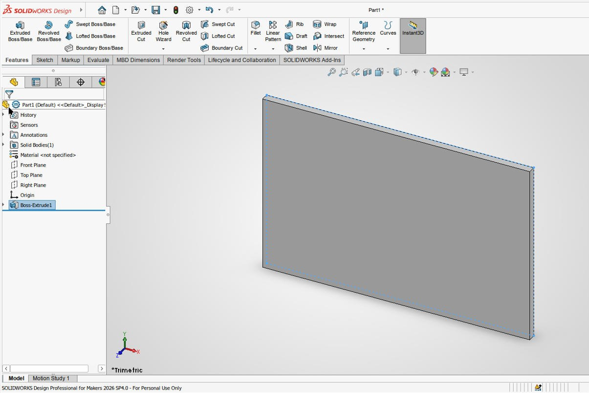

# SOLIDWORKS on Linux with Wine

How to install and run **3DEXPERIENCE SOLIDWORKS for Makers (R2026x, SOLIDWORKS 2026 SP4)** natively on Linux under Wine, without a virtual machine. It covers the tools, scripts and every fix that one working install needed. A second guide covers **desktop SOLIDWORKS with a serial number** (a standalone company licence), installed with the SOLIDWORKS Installation Manager: [docs/INSTALL-STANDALONE.md](docs/INSTALL-STANDALONE.md).

> Not affiliated with or endorsed by Dassault Systèmes or Microsoft. SOLIDWORKS, 3DEXPERIENCE and WebView2 are their owners' trademarks.
> **You need your own valid SOLIDWORKS licence**: a 3DEXPERIENCE subscription you sign in to, or a serial number you activate, exactly as on Windows. Nothing here removes, bypasses or alters any licensing. The fixes only add Windows behaviour that Wine is missing. This repository contains no Dassault or Microsoft files. You download those yourself.



## Status

This is the result of one working install, not a polished installer. Read the whole page before you start.

| | |
|---|---|
| Works | Installing with Dassault's own installer; the real 3DEXPERIENCE sign-in page; licence accepted ("Professional for Makers 2026 SP4.0"); new part, sketch, extrude, fillet; PropertyManager buttons and number boxes; the menus, right-click menus and toolbar flyouts; saving, Save As and STEP export; opening existing parts from File > Open and by double-clicking them in the file manager; Open/Save dialogs in KDE's own file dialog (with Wine's dialog and your Linux folders as the fallback) |
| Serial-number install | SOLIDWORKS Design Standard 2026 SP5.2 with a standalone serial (Wine 11.21): the SOLIDWORKS Installation Manager's pages, serial entry and server check, its prerequisites, the SOLIDWORKS MSI installed directly, activation over the Internet, a new part with sketch and extrude; eDrawings and File Utilities. See [INSTALL-STANDALONE.md](docs/INSTALL-STANDALONE.md) for what is and isn't tested |
| Not tested | Assemblies, drawings, Simulation, Visualize, add-ins; other distributions and other Wine versions; Proton; a fresh install done only with these scripts (see below) |
| NVIDIA GPU | `SW_GPU=nvidia` draws the 3D view on the NVIDIA GPU of a hybrid laptop (PRIME render offload). Tested on an RTX 3070 laptop GPU with drivers 615.71 and 620.70: new parts, sketches, dimension and selection-box drags, extrudes, view changes, the view triad, dialogs over the view, opened parts and saving all draw and work normally. That mode needs further win32u changes and one Wine OpenGL setting, all applied by the wrapper (see [FIXES.md](docs/FIXES.md)). The default is the integrated GPU |

**Tested on:** Fedora 44 KDE Plasma (Wayland, SOLIDWORKS runs through XWayland), Fedora's `wine-core` 11.20 and 11.21 (Wine Staging, WoW64 build), winetricks 20260125, Intel Iris Xe (Mesa 26.2) plus an NVIDIA RTX 3070 laptop GPU (drivers 615.71 and 620.70), 23 GB RAM.

**About the scripts:** the original install was done by hand, step by step, and the scripts in `install/` were written from it afterwards. Each script was checked on its own against a scratch prefix and the files of the working install:

- the prefix setup was run from scratch;
- the MSI patches, applied to an untouched SOLIDWORKS MSI, give the same feature table and the same edited rows as the working install;
- the answer file comes out identical;
- the WebView2 registry entries and launcher fixes match;
- the patched Wine files are byte-identical.

The full chain from a blank prefix to a running SOLIDWORKS has **not** been re-run with the scripts. Expect to read logs. Issues and fixes are welcome.

## How it works

SOLIDWORKS always runs through `bin/sw-wine`. This wrapper starts Wine inside [bubblewrap](https://github.com/containers/bubblewrap) and, for that process tree only:

- hides `/dev/ntsync`;
- gives Wine's computer name a hosts entry;
- swaps in patched private copies of nine Wine files: `ntdll.dll`, `wininet.dll` (the 64-bit one, and the 32-bit one the Installation Manager uses), `shell32.dll`, `uxtheme.dll`, `comctl32_v6.dll`, `win32u.so` (with extra changes when you use the NVIDIA GPU), `winex11.so` and `wineserver`;
- registers `swfiledlg.dll`, which shows KDE's file dialog (`kdialog`) for SOLIDWORKS' Open, Save As and Export dialogs.
- registers `swopenfolder.exe`, so folders SOLIDWORKS opens through the Windows shell show up in Dolphin, not in Wine's file browser, and "Show in Folder" shows the file selected there.

The patched copies are generated from *your* Wine's own files on first use and regenerated after a Wine update. Your system's Wine is never modified. [docs/FIXES.md](docs/FIXES.md) explains every fix: what broke, why, and what was changed.

## Install

The full walkthrough is in **[docs/INSTALL.md](docs/INSTALL.md)**. In short:

```bash
git clone https://github.com/ezeren76neptune/solidworks-wine.git ~/solidworks-wine && cd ~/solidworks-wine
tools/build.sh                                   # compile the Wine additions (needs gcc, binutils)
install/setup-prefix.sh                          # Wine prefix: .NET 4.8, fonts, MSXML, Windows 11, settings
install/install-webview2.sh <WebView2 runtime>   # for the sign-in page
install/stage-media.sh <SOLIDWORKS bootstrap .zip>
install/download-cafs.sh                         # ~7 GB of installer archives from Dassault
install/make-install-json.py --tenant <your platform ID>
install/run-installer.sh                         # Dassault's installer; stops at the SOLIDWORKS MSI
install/patch-msis.sh && install/install-msis.sh # MSI fixes, install SOLIDWORKS + Visualize
install/run-installer.sh                         # second run finishes the install
install/fix-desktop-entries.sh                   # make the icons use the wrapper
bin/sw-wine wine 'C:\users\Public\Desktop\SOLIDWORKS Design.lnk'
```

Then sign in, and turn off **Tools > Options > Performance > Enhanced graphics performance**. Otherwise the 3D view stays black.

For a serial-number licence, follow [docs/INSTALL-STANDALONE.md](docs/INSTALL-STANDALONE.md) instead. In short: the same tools and prefix setup, the Installation Manager with `tools/build/autoattach.exe` running so you can type into it, then `install/install-sim-msi.sh`, `install/install-sim-extras.sh` and `install/wpf-fixes.sh` for the parts it can't install under Wine, and activation on first start.

If something goes wrong, see [docs/TROUBLESHOOTING.md](docs/TROUBLESHOOTING.md).

## Requirements

- x86-64 Linux with Wine 11.x (Staging), `winetricks`, `bwrap` (bubblewrap), `python3`, `gcc` + `binutils` (`ld`, `objcopy`, `nm`), `curl`, `unzip` or `7z`, `cabextract`. You need `podman` only for the optional file-dialog places DLL.
- About 45 GB of free disk space (the prefix ends up around 36 GB) and a working OpenGL driver.
- A 3DEXPERIENCE SOLIDWORKS for Makers subscription, plus the SOLIDWORKS installer media and the WebView2 runtime (see INSTALL step 2). Or, for the second guide, a SOLIDWORKS serial number and the Installation Manager download; `podman` then builds `autoattach.exe`, and the optional terminal control needs the Python package `websockets`.
- The binary patches look for exact code patterns in Wine's files. On a different Wine build they may not find them: the wrapper then reports this and leaves that file alone, or stops in the case of `ntdll`. The `ntdll` patch also needs a Wine build whose PE DLLs keep their symbol table, as Fedora's do.

## Repository layout

| Path | What |
|---|---|
| `bin/sw-wine` | the wrapper every Wine command for this prefix goes through |
| `install/` | install scripts, the installer answer-file generator, MSI fixes, archive list; `install-sim-*.sh` and `wpf-fixes.sh` for the serial-number install |
| `tools/` | the Wine additions (C sources, PE/ELF patchers), the file-dialog places DLL, MSI tools, tests; `autoattach.c` and `sim-cdp.py` for the Installation Manager |
| `docs/` | install guides (Makers, serial number), explanation of every fix, troubleshooting |

## Credits

- Denis Bonnenfant's patch for [Wine bug 27403](https://bugs.winehq.org/show_bug.cgi?id=27403) (`WM_CAPTURECHANGED`), applied here in binary form.
- [cryinkfly's SOLIDWORKS-on-Linux project](https://codeberg.org/cryinkfly/SolidWorks-on-Linux) and the WineHQ AppDB reports, for earlier groundwork on SOLIDWORKS under Wine.
- The Wine project. `tools/ntdll_add.c` mirrors parts of Wine's `dlls/ntdll/loader.c`.

## License

LGPL-2.1-or-later (see [LICENSE](LICENSE)), the same as Wine, because parts are derived from Wine's code.
